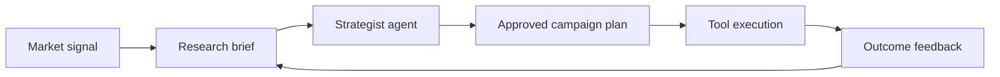

# AI-GTM

> Turn market signals into approved GTM work your team can execute.

AI-GTM is a strategy workbench for research, planning, approval, and execution workflows. It combines agent workflows with operational tools rather than presenting an ungrounded chatbot.

## Strategy workflow

## Design principles

- Agent reasoning is visible and reviewable.
- Approval gates are explicit before external actions.
- Tool boundaries and credentials are documented.
- Research stays connected to an executable next step.

`strategist_agent/` contains strategy workflows, while `invoice_system/` contains invoice automation.
