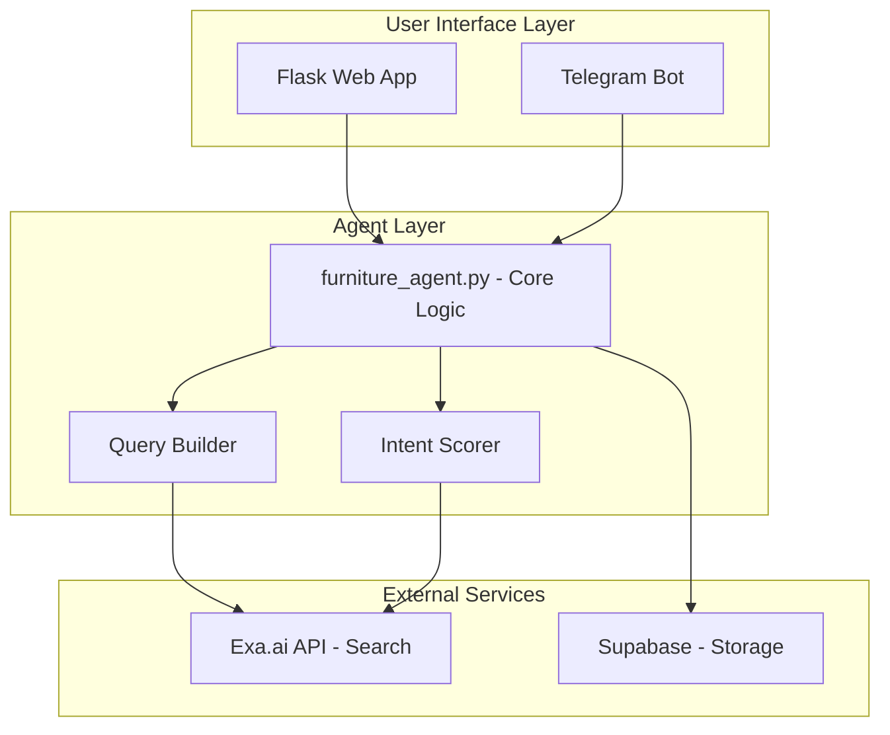
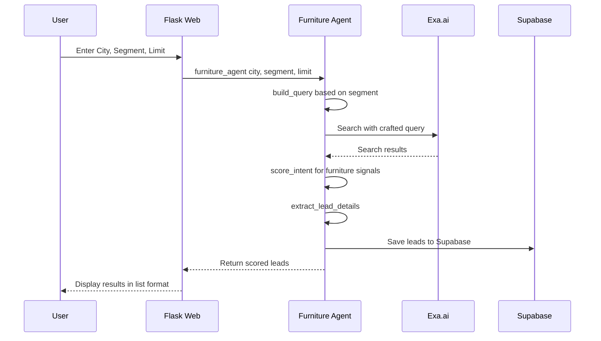

# Furniture Lead Agent - Implementation Plan

## Overview

A lead generation agent that finds new buildings, offices, and commercial spaces with potential for furniture sales. Similar to Hunter Agent's UI/UX but tailored for the furniture industry.

## Architecture



## Project Structure

```
furniture-agent/
furniture-agent/.env
furniture-agent/agent.py              # Core logic
furniture-agent/app.py                # Streamlit app
furniture-agent/bot.py                # Telegram bot
furniture-agent/requirements.txt
furniture-agent/supabase_client.py
```

## UI/UX Design - Streamlit Interface

### Web Interface - Streamlit App

| Field | Type | Description |
|-------|------|-------------|
| City | Text Input | Target city for lead search |
| Segment | Select Box | Type of building/space |
| Limit | Slider | Max results to return (1-20) |
| Search Button | Button | Execute lead search |

| Segment | Search Query Pattern |
|---------|---------------------|
| Office | new office building construction OR office space opening OR corporate office expansion |
| Coworking | coworking space opening OR shared office launch OR new coworking center |
| Hotel | new hotel opening OR hotel renovation OR hospitality project |
| Restaurant | new restaurant opening OR cafe launch OR dining space renovation |
| Residential | new apartment complex OR residential project launch OR housing development |
| Retail | new retail store opening OR shopping mall expansion OR showroom launch |

### Intent Scoring for Furniture Sales

| Signal | Score | Keywords |
|--------|-------|----------|
| High Intent | 9-10 | new opening, grand opening, construction complete, fit-out, interior design |
| Medium Intent | 7-8 | renovation, expansion, refurbishment, redesign |
| Low Intent | 4-6 | planning, proposed, upcoming, future |

### Results Display

Streamlit displays results in an interactive format:
- **Metrics Row**: Total leads found, average intent score
- **Lead Cards**: Expandable cards showing:
  - Company/Building Name
  - Website/Source Link
  - Intent Score with color-coded badge
  - Intent Signal - snippet showing why matched
  - Contact Potential - estimated decision maker role
- **Data Table**: Sortable, filterable table view
- **Export Option**: Download results as CSV

## Data Flow



## Implementation Details

### 1. agent.py - Core Agent Logic

```python
# Key functions:
- build_query(city, segment) -> str
- search_with_exa(query, limit) -> list
- score_intent(text) -> int
- extract_lead_details(results) -> list
- furniture_agent(city, segment, limit) -> list
```

### 2. app.py - Streamlit Web App

- Streamlit form for city, segment, limit
- Real-time search with progress indicator
- Metrics display for results summary
- Interactive lead cards with expanders
- Data table view with sorting/filtering
- CSV export functionality
- Integration with Supabase storage

### 3. bot.py - Telegram Bot

- Commands:
  - /start - Welcome message
  - /hunt <City> <Segment> - Search for leads
- Response formatting for mobile display
- Supabase integration

### 4. templates/index.html

- Clean, minimal form design
- Results list with score badges
- Responsive layout
- Clear visual hierarchy

### 5. supabase_client.py

- Connection management
- Lead storage function
- Error handling

## Configuration

### Environment Variables

```env
EXA_API_KEY=your_exa_api_key
SUPABASE_URL=your_supabase_url
SUPABASE_KEY=your_supabase_key
TELEGRAM_BOT_TOKEN=your_telegram_token
```

### Supabase Table Schema

```sql
CREATE TABLE furniture_leads (
    id UUID PRIMARY KEY DEFAULT uuid_generate_v4(),
    company TEXT,
    website TEXT,
    intent_signal TEXT,
    intent_score INTEGER,
    city TEXT,
    segment TEXT,
    decision_maker_role TEXT,
    created_at TIMESTAMP DEFAULT NOW()
);
```

## Comparison with Hunter Agent

| Aspect | Hunter Agent | Furniture Lead Agent (Streamlit) |
|--------|--------------|----------------------------------|
| UI Framework | Flask + HTML | Streamlit (Python-native) |
| Target | Coworking/Architect/Corporate | Office/Hotel/Restaurant/Retail/Residential |
| Intent Signals | Office expansion signals | Furniture buying signals |
| Scoring | Based on expansion keywords | Based on interior/furniture keywords |
| Output | Lead with intent score | Lead with furniture potential score |
| Features | Basic form + list | Interactive cards, metrics, CSV export |

## Next Steps

1. Create project directory structure
2. Implement agent.py with furniture-specific logic
3. Create Flask web interface
4. Implement Telegram bot
5. Set up Supabase integration
6. Test with real searches
7. Deploy and monitor